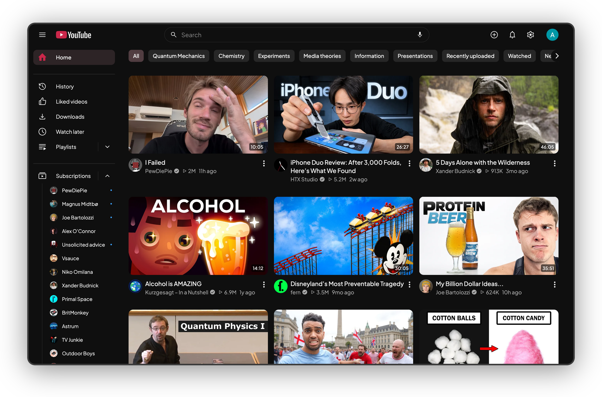
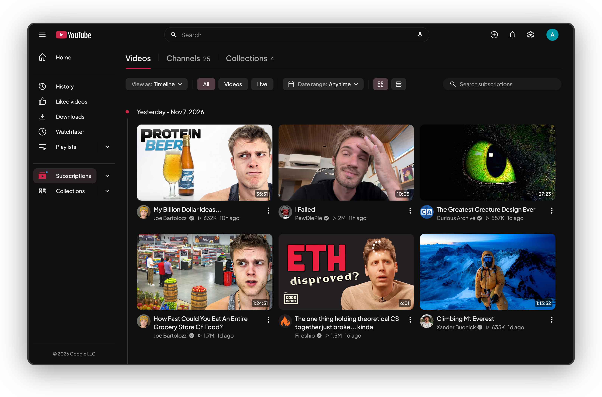
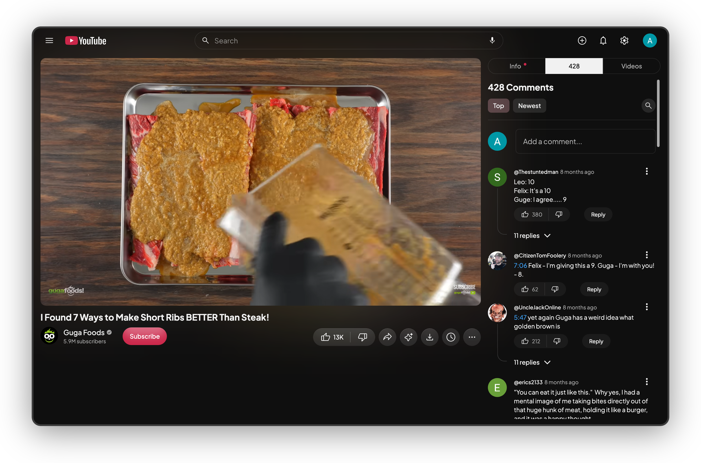
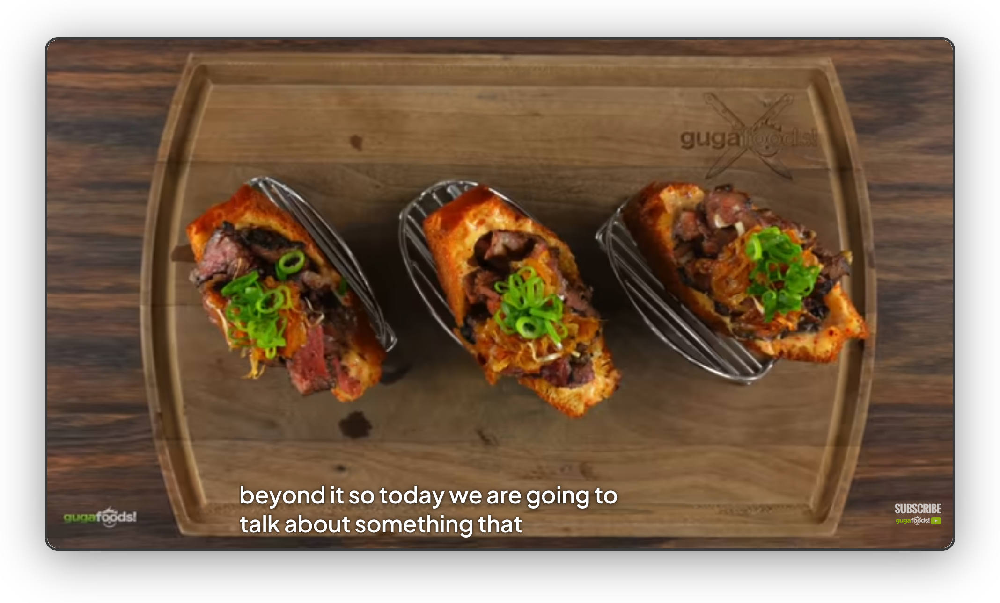
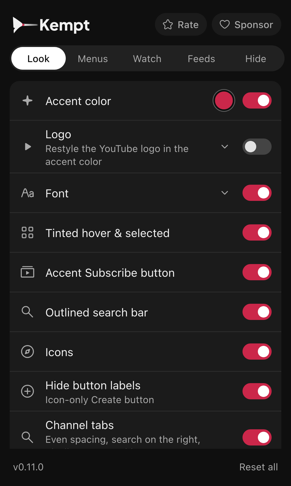

<div align="center">


<h1>Kempt for YouTube</h1>

<p align="center">
  <a href="https://remonilo.github.io/kempt-yt/docs/">Docs</a>
  ·
  <a href="https://remonilo.github.io/kempt-yt/docs/installation/">Install</a>
  ·
  <a href="https://remonilo.github.io/kempt-yt/docs/faq/">FAQ</a>
  ·
  <a href="https://remonilo.github.io/kempt-yt/docs/privacy/">Privacy</a>
</p>

<p align="center">
  <a href="https://addons.mozilla.org/firefox/addon/kempt-for-youtube/"></a>
  <a href="https://chromewebstore.google.com/detail/kempt-for-youtube/dpiheahglgggkdjcgdkiogpmhbmppfmg"></a>
  <a href="LICENSE"></a>
  <a href="https://github.com/remonilo/kempt-yt/commits/main"></a>
</p>

### This restyles and tidies Youtube.

Free and open source, for Firefox and Chrome.

</div>

<div align="center">
  <table>
    <tr>
      <td colspan="2">  
        
      </td>
    </tr>
    <tr>
      <td width="50%">
        
      </td>
      <td width="50%">
        
      </td>
    </tr>
  </table>
</div>
<p align="center">
  <sub>Follows YouTube's light and dark theme. The accent color is changeable.</sub>
</p>
<br>

> [!NOTE]
> **Kempt only changes how YouTube looks.**
>
> It doesn't block ads or download anything. It moves and restyles YouTube's own elements, and every button keeps YouTube's own behavior.

## Features

- Watch page tabs for info, comments, videos, live chat and Ask AI, beside the player. Only the open tab scrolls. <details> <summary><sup>click to see the tabs</sup></summary></details>
- Readable captions in your font: Shadow, Box or Blur, sized 50 to 200% <details> <summary><sup>click to see the captions</sup></summary></details>
- Subscriptions on a timeline with date headers, Videos and Channels tabs, filter chips and a search box
- Collections: your own groups of channels, each with its own feed and a sidebar entry
  - History gets the same date headers
  - optionally open Subscriptions as your Home page
- Sidebar with dropdowns for Explore, Subscriptions, Collections and Playlists
- One accent color and one icon set across chips, tabs, the progress bar, Subscribe, buttons and menus
  - an optional accented logo and progress bar styles
- Font choice, bundled in the extension: Plus Jakarta Sans by default, or Inter, Geist, Figtree or your system font
- Grid size for Home, Subscriptions and channels, and search results as a grid or a list, with a custom date range
- Shorts links open in the normal player, with a seek bar
- Shorts hidden by default, plus 22 more switches in the Hide tab
- Smaller fixes: outlined search bar, Watch later button, comment sort as chips, comment search, Watch later and Share in the notifications panel
- Each feature turns off on its own, and YouTube's page comes back without a reload. <details> <summary><sup>click to see the popup</sup></summary></details>
- Labels in 11 languages that follow YouTube's UI language
- CSS first, no background timers, observers that disconnect once done, and respereduced motion ([measured](https://remonilo.github.io/kempt-yt/docs/internals/performance/))

## Quick start

[<kbd><br>install<br></kbd>][install_link]
[<kbd><br>settings<br></kbd>][settings_link]
[<kbd><br>faq<br></kbd>][faq_link]
[<kbd><br>how it works<br></kbd>][internals_link]

## Installation

### Firefox

Firefox 128 or later: [Firefox Add-ons][firefox_link].

### Chromium browsers

Chrome 120 or later, Edge, Brave or any other Chromium browser: [Chrome Web Store][chrome_link].

### From source

You need Node.js 22 or later.

```sh
git clone https://github.com/remonilo/kempt-yt
cd kempt-yt
npm i
npm run build
```

- In Firefox, open `about:debugging` → This Firefox → Load Temporary Add-on → `dist/manifest.json`.
- In Chrome, open `chrome://extensions` → Developer mode → Load unpacked → `dist/`.

Reload any YouTube tab that was open before.

## Privacy

Kempt collects no data and has no server. It loads no remote code and runs no analytics.

| Permission                  | Why                                                                               |
| --------------------------- | --------------------------------------------------------------------------------- |
| `storage`                   | Saves your settings. Your browser may sync them through your own browser account. |
| `https://www.youtube.com/*` | Runs Kempt on YouTube. It runs on no other site.                                  |

The few requests it makes go to YouTube with your session, and YouTube's own menus send the same ones. [Details][privacy_link].

Every [GitHub release](https://github.com/remonilo/kempt-yt/releases) attaches the zip built by CI from that tag (`npm ci && npm run build`) and a source zip. Release notes are in the [changelog](CHANGELOG.md).

## Contributing

```sh
npm run dev      # watch build into dist/
npm run check    # typecheck
npm test         # node --test
```

Kempt is TypeScript with no framework or runtime dependencies. A feature is one folder in `src/features/<id>/` and one line in `src/features/index.ts`. Start with [Adding a feature][add_link]. [YouTube quirks][quirks_link] records the lessons learned about YouTube's DOM.

A bug report helps most when it includes your browser, window width, YouTube language, signed in or out, and the steps to reproduce.

The docs site lives in `site/` (Astro + Starlight): `cd site && npm i && npm run dev`.

## Translations

Kempt's own labels exist in English, Spanish, Portuguese, German, French, Russian, Japanese, Korean, Hindi, Indonesian and Turkish. No native speaker helped write the non-English ones. If you speak one, read the `WORDS` tables in `src/features/*/index.ts` and open a PR.

## Motivation

YouTube's UI is built from many teams' parts. It mixes three icon styles, and its accents change from page to page. Years of added features left clutter on top. Kempt pulls it all into one design. It started from Juxtopposed's YouTube redesign concept and grew into something I use every day.

## Credits

Icons from [YouTube Redesign (Community)](https://www.figma.com/community/file/1450380484645543336/youtube-redesign) by Juxtopposed, licensed under [CC BY 4.0](https://creativecommons.org/licenses/by/4.0/), exported and modified. Remaining icons from [Hugeicons](https://hugeicons.com) (MIT). Fonts (Inter, Plus Jakarta Sans, Geist, Figtree) are under the SIL Open Font License 1.1. Kempt for YouTube is an independent project, not affiliated with or endorsed by YouTube or Google. YouTube is a trademark of Google LLC.

## Support

Kempt is free and I maintain it alone. [Sponsor on GitHub](https://github.com/sponsors/remonilo) if it saves you some annoyance. A rating on [Firefox Add-ons][firefox_link] or the [Chrome Web Store][chrome_link] helps others find it.

## License

Code: [MIT](LICENSE). Bundled icons and fonts keep their own licenses, see [THIRD_PARTY_NOTICES.md](THIRD_PARTY_NOTICES.md).

<!---------------------------------------------------------------------------->

[firefox_link]: https://addons.mozilla.org/firefox/addon/kempt-for-youtube/
[chrome_link]: https://chromewebstore.google.com/detail/kempt-for-youtube/dpiheahglgggkdjcgdkiogpmhbmppfmg
[install_link]: https://remonilo.github.io/kempt-yt/docs/installation/
[settings_link]: https://remonilo.github.io/kempt-yt/docs/settings/
[faq_link]: https://remonilo.github.io/kempt-yt/docs/faq/
[internals_link]: https://remonilo.github.io/kempt-yt/docs/internals/architecture/
[add_link]: https://remonilo.github.io/kempt-yt/docs/internals/adding-a-feature/
[quirks_link]: https://remonilo.github.io/kempt-yt/docs/internals/youtube-quirks/
[privacy_link]: https://remonilo.github.io/kempt-yt/docs/privacy/
