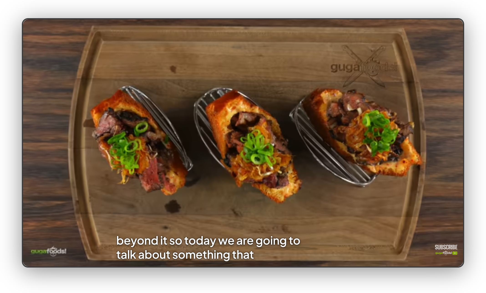

Captions are white semibold text in the font you picked under [Font](/kempt-yt/docs/features/look/#font). They are sized to the player, so they grow in theater mode and fullscreen. When the controls show, captions slide up out of their way in 200 ms both ways (no animation with reduced motion).

## Settings

The switch is **Watch page → Captions**, on by default.

| Option | Choices | Default |
| --- | --- | --- |
| Style | Shadow, Box, Blur | Shadow |
| Size | 50% to 200% in 10% steps | 100% |

- **Shadow** draws a soft shadow behind the text and no box.
- **Box** puts one rounded dark plate behind the whole caption.
- **Blur** puts a lighter plate behind it that blurs the video. A blur over moving video redraws with every frame, so it costs some GPU work while captions show.

Size applies while you drag the slider. YouTube's own Subtitles → Options entry is hidden while the feature is on, because Kempt's style wins over it. Turn Captions off to get YouTube's caption settings back.

## How it works

- The feature is mostly CSS. YouTube writes its caption settings as inline styles, so Kempt's rules use `!important`.
- The size is `4.6cqh` of the caption container (clamped to 13 to 48 px), times the Size slider. YouTube's own default measures about `4.4cqh`.
- YouTube sizes each caption window for its own text. A centred window gets the width of Kempt's text and centres on YouTube's anchor, so placement and dragging keep working. Windows anchored at an edge keep YouTube's position.
- Auto-generated captions (rollup windows) keep YouTube's width, height and clip, so old lines still scroll out of the top. YouTube makes that window wider than its text, so Box and Blur give each line its own plate there.
- YouTube moves the caption on the first mousemove of a drag. The browser then starts its own drag from whatever is under the press point by then (the video), which swallows the mouseup, so the caption stayed stuck to the cursor. The feature's only script cancels a native drag that starts in the player's video container.
