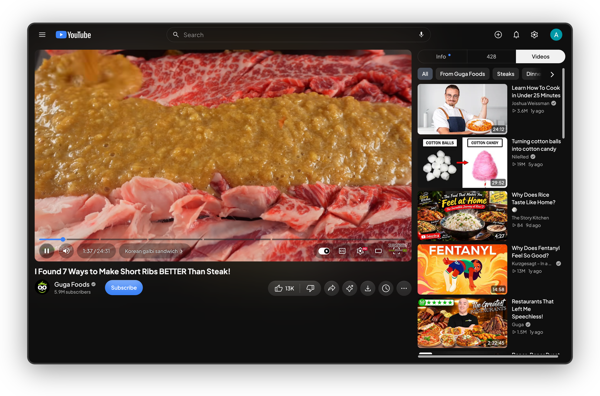

The Look tab's switches make YouTube's surfaces agree with each other. Most are CSS only.

## Accent color

The accent is one color for every "selected" or "active" mark: chips, tabs, the progress bar, the selected sidebar icon. The default is `#cb274a`, the same red as the Subscribe button, so the page has one red. Pick any other color in the popup.

YouTube styles itself with CSS variables such as `--yt-spec-static-brand-red`. Kempt points them at `--kyt-accent`, plus a few targeted rules for chips, tabs and the progress bar. The popup saves your color; the content script writes it onto `<html>` as `--kyt-accent`, and everything follows.

## Font

One typeface for all of YouTube's text, Kempt's own labels included. The default is Plus Jakarta Sans. The popup also offers Inter, Geist, Figtree and System (your operating system's UI font). With [Captions](/kempt-yt/docs/features/captions/) on, captions use it too; with Captions off they keep the font set in YouTube's caption settings.

The fonts ship inside the extension as variable WOFF2 files, so nothing loads from a font service. The feature adds one `<style>` of `@font-face` rules, split by `unicode-range` (Latin, Latin Extended, Cyrillic, Greek, Vietnamese where the font has them). The browser downloads only the faces the page's text needs: about 50 KB for an English page. One CSS rule sets `font-family` on every element in the page, with YouTube's own `Roboto, Arial, sans-serif` behind it, so Japanese, Korean or Hindi text falls back to YouTube's fonts. Each font family name carries a `kyt` prefix, so a copy you installed yourself never stands in.

## Tinted hover and selected

Every hover, and every selected item such as the sidebar entry or a feed chip, gets a faint tint of the accent instead of YouTube's grey.

The tint is translucent, `color-mix(in srgb, accent 40%, #fff)` at 14% in dark mode and 30% in light. It works on any background and follows a custom accent. Selected text stays in the normal text color and only the icon turns accent, because accent text on the dark tint falls under 3:1 contrast.

## Subscribe button

Subscribe is the accent. Its text is white on a dark accent and black on a light one: the CSS reads the accent's OKLCH lightness and switches at 0.68. Once you're subscribed, the button goes back to neutral.

## Search bar

The search box becomes one outlined pill, with the magnifier on the left and the microphone inside. Suggestions line up with the pill and use the same frosted surface as the top bar.

This one is CSS only. The search button moves left with flex `order: -1`, and the microphone sits inside the box. YouTube shipped a new search box (`yt-searchbox`) in 2025, and the rules cover both versions.

## Logo

Off by default. The YouTube logo's play button takes the accent color in one of four styles: Pixel play button, Snake, Comet or Paper boat. The last three pair with the [Fun progress bar](/kempt-yt/docs/features/progress-bar/) styles of the same name. The wordmark and region code stay YouTube's. Each style animates once when the page loads and again on hover; with reduced motion on, it stays still.

It is CSS only: YouTube's icon is hidden and pseudo-elements draw the new one in its place, so the logo keeps its link.

## Hide button labels

On by default. The Create button in the top bar shows only its icon. YouTube already draws Share, Save, Download and Shop icon-only on narrow pages; this makes Create match everywhere. It works with or without Kempt's [Icons](/kempt-yt/docs/features/icons/).

## Channel tabs

On by default. A channel's tabs (Home, Videos, Live, Playlists and the rest) get even spacing and the accent underline, with the search box moved to the right end of the row. On the Playlists tab, YouTube's sort dropdown becomes chips.

## Light and dark

Every color is a token in `src/theme/tokens.css` with a light and a dark value. Kempt follows YouTube's own theme setting.
