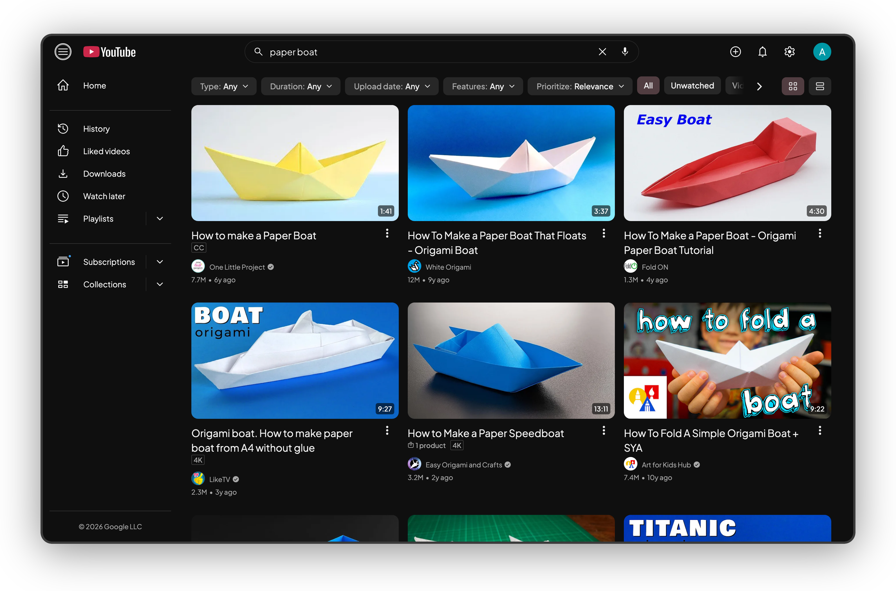

Three Feeds switches restyle the pages you reach from the sidebar and the search box. All three are on by default.

## Search filters

**Feeds → Search filters and grid** replaces YouTube's Filters dialog with one chip per filter group above the results: Upload date, Type, Duration, Features and Prioritize. A chip opens its options as a dropdown; options toggle the way they do in YouTube's dialog, and Features can hold several.

Upload date also offers a **Custom range**: exact days, or whole years picked as chips. YouTube honours `after:` and `before:` in the search query, so Kempt adds those to your search and the range survives sharing the URL.

Results show as a grid or a list (option **Results layout**, default Grid, or the chips at the end of the row). Shelves of videos inside the results join the grid.

## Playlist pages

**Feeds → Playlist pages** gives a playlist a header card with the title, owner and stat pills (videos, views, last update, total duration), and Play all, Shuffle and the header actions as buttons instead of a menu. Videos sit in a list with a search box and a "Sort by" row.

- **Bulk select**: tick videos to delete them from the playlist, add them to another playlist or add them to the queue in one go.
- **Library** (`/feed/playlists`) shows your playlists as cards with the owner, Play all, Copy link, Edit and Delete, and a search box. Option **Library layout** picks List (default) or Grid.
- Other people's playlists get the same header, with their total duration. Courses keep their About dialog.

## Downloads page

**Feeds → Downloads page** gives Downloads the same header and margins as History, so the two pages line up.

## How it works

- Search filters read YouTube's own filter links from the page data and navigate to them, so every filter is a normal YouTube search URL. Each change is a new navigation, and the chips rebuild per page.
- Playlist header buttons and bulk actions run the commands YouTube attached to its own buttons and menus, through the [page bridge](/kempt-yt/docs/internals/page-bridge/). YouTube's own markup stays in the page, hidden.
- Downloads has no page marker for CSS, so Kempt stamps its page element once per visit.
