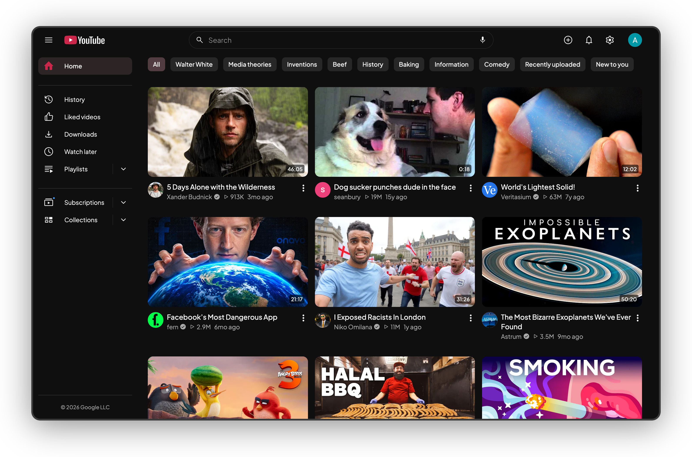

Kempt is a browser extension that restyles YouTube in your accent color. It runs on Firefox 128+ and on Chromium 120+ browsers.

## What changes

| Where                  | Change                                                                                                               |
| ---------------------- | -------------------------------------------------------------------------------------------------------------------- |
| Watch page | Info, Comments, Videos, Live chat and Ask AI as tabs beside the player. Readable captions, chips and search for comments, a Watch later button and an optional fun progress bar. |
| Subscriptions, History | A timeline with date headers. Subscriptions also gets type chips, a date range, search and a Channels tab. |
| Search, playlists, Library | Filter chips with a custom date range and grid results; a playlist header card with bulk select; Library and Downloads in History's layout. |
| Sidebar | Explore, Subscriptions and Playlists as dropdowns. Hide the entries you don't use. |
| Everywhere | One accent color, tinted hover and selection, one icon set, one font, an outlined search bar, Settings in the top bar, an optional accent logo. |
| Hide | Shorts, with Shorts links opening in the normal player, plus 22 more switches in the Hide tab. |

Each feature turns off on its own in the popup. Its CSS and code stop, and anything it moved goes back, without a reload.

## How these docs are organized

- **Start here** covers installing, the popup, common questions and privacy.
- **Features** has one page per feature: what it does, its settings, then how it works and its limits.
- **How it works** is for contributors: the core model, the bridge into YouTube's page, the performance rules and how to add a feature.

## Design rules

Kempt follows four rules, and every feature page shows how it applies them.

1. CSS before JS. A visual change is a stylesheet rule. Code runs only to add, move or read something, or to change navigation.
2. Every feature is reversible. Turning it off restores YouTube's page without a reload.
3. No polling and no page-wide observers. Kempt reacts to YouTube's own navigation event and watches only the containers it needs.
4. YouTube's selectors live in one place each, so a YouTube update is one `grep` away from a fix.
