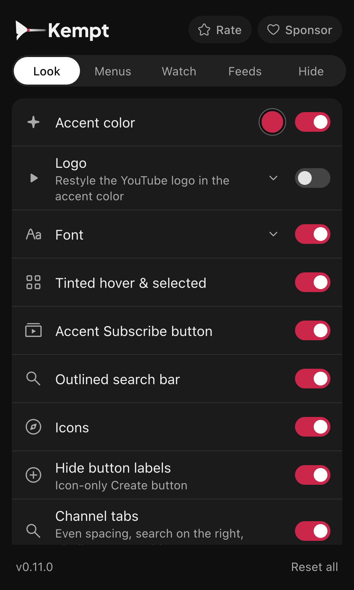

Click the Kempt icon in the browser toolbar. The tabs at the top switch between the groups below (Look, Menus, Watch, Feeds, Hide), and the popup reopens on the last one. Changes apply to open YouTube tabs at once.

## Switches

| Group | Switch | Options | Default |
| --- | --- | --- | --- |
| Look | [Accent color](/kempt-yt/docs/features/look/) | Any color | On, `#cb274a` |
| | [Tinted hover & selected](/kempt-yt/docs/features/look/#tinted-hover-and-selected) | | On |
| | [Font](/kempt-yt/docs/features/look/#font) | Plus Jakarta Sans, Inter, Geist, Figtree, System | On, Plus Jakarta Sans |
| | [Accent Subscribe button](/kempt-yt/docs/features/look/#subscribe-button) | | On |
| | [Outlined search bar](/kempt-yt/docs/features/look/#search-bar) | | On |
| | [Icons](/kempt-yt/docs/features/icons/) | | On |
| Menus | [Redesigned sidebar](/kempt-yt/docs/features/sidebar/) | Hide "You", "Your channel", "Your videos", "Courses" | On, all hidden |
| | [Settings in top bar](/kempt-yt/docs/features/top-bar/) | | On |
| | [Watch later button](/kempt-yt/docs/features/top-bar/#watch-later-button) | | On |
| | [Notification actions](/kempt-yt/docs/features/top-bar/#notification-actions) | | On |
| Watch | [Tabs](/kempt-yt/docs/features/watch-tabs/) | Ask AI on or off; as an icon button or a tab; dot on Info for cards | On, dot on |
| | [Comment sort as buttons](/kempt-yt/docs/features/comment-sort/) | | On |
| | [Comment search](/kempt-yt/docs/features/comment-search/) | | On |
| | Comment layout | | On |
| | [Captions](/kempt-yt/docs/features/captions/) | Style Shadow, Box or Blur; Size 50% to 200% | On, Shadow, 100% |
| | [Wavy progress bar](/kempt-yt/docs/features/progress-bar/) | Animate wave | Off |
| Feeds | [Timeline](/kempt-yt/docs/features/timeline/) | | On |
| | [Grid size](/kempt-yt/docs/features/grid/) | Videos per row (2 to 8), Shorts per row (3 to 10) | Off |
| Hide | [Shorts](/kempt-yt/docs/features/shorts/) | | On |
| | [Home feed, chips, Explore, Subscriptions, watch page parts, top bar buttons, Mixes, Playables, search shelves](/kempt-yt/docs/features/hide/) | | Off |
| | [Subscriptions as Home](/kempt-yt/docs/features/hide/#subscriptions-as-home) | | Off |
| | [Autoplay](/kempt-yt/docs/features/hide/#autoplay) | | Off |

## The color picker

The dot in the Accent color row opens a picker: swatches, a hue and saturation wheel, a brightness slider and a hex field. Everything that uses the accent follows it, including the tint behind selected items and the Subscribe button.

## Sync and reset

Kempt saves settings with `chrome.storage.sync`, so they follow your browser account to other computers. The popup footer shows the version and a **Reset all** button; click it twice to confirm.

## How it works

The popup has no list of its own. It reads the same feature list the extension runs (`src/features/index.ts`) and draws one row per feature from its `label`, `hint`, `icon`, `group` and `options`. A new feature appears in the popup with no popup changes.

When a color or number option names a `cssVar`, Kempt writes it straight onto `<html>` as a CSS variable. Number options with `slider: true` draw as a range input and apply while you drag. Boolean options become attributes such as `kyt-sidebar-hide-you`, which the feature's CSS matches. Live drags save at most every 400 ms, because `storage.sync` allows 120 writes a minute.
